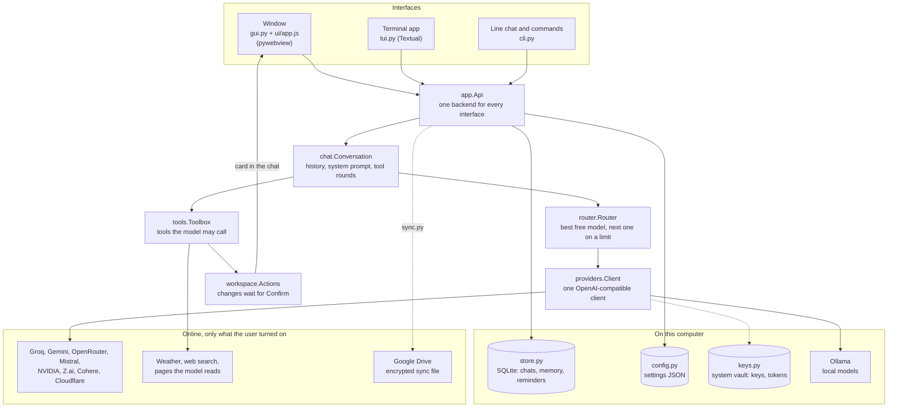

# How Lanterna works

This is a map of the code for people who want to read it, change it, or check whether it is safe. It describes
version 1.x on the `main` branch. For what the app does, see the [README](README.md). For keys, data and
reporting a vulnerability, see [SECURITY.md](SECURITY.md).

Lanterna is one Python package (`src/lanterna`) with three ways to use it: a window, a full-screen terminal app
and a plain line-by-line chat. All three talk to the same backend, so a chat started in the window is there in the
terminal too.

## The big picture

## One message, start to finish

1. **The interface sends the text.** The window calls `Api.send()` through pywebview and gets back a stream id,
   then polls `Api.poll()` for new pieces. Polling is simpler than pushing events from Python into the page, and it
   works the same in the browser dev mode (`lanterna-gui --browser`), where every call is a plain HTTP request
   with a random token.
2. **`Conversation.ask()` builds the request** (`chat.py`): the system prompt (personality from `soul.py`, the
   date, the user's memory, rules about honesty and tools), the last 30 messages and the new one. A long chat
   keeps a summary of its older part instead of sending all of it.
3. **The toolbox picks the tools to offer** (`Toolbox.schemas`). Tools are grouped (the user's folders, programs,
   PC settings, mail…). A group is offered only when the recent messages are about it. Every tool description
   costs tokens on free plans, and small models choose better from a short list.
4. **The router picks a model** (`router.py`). Models are ranked by `discovery.py` (free ones only: OpenRouter
   models priced at 0, and the free tiers of the other services). The router tries the best one. If it hits a
   rate limit, a network error or times out, that model (or the whole service, for a bad key) rests for a while
   and the next model answers. The interface shows a small "switched to …" note. A model that started answering is
   never swapped halfway, so one reply never mixes two models.
5. **Tool rounds.** If the model asks for tools, `Toolbox.run()` runs them and the results go back to the model.
   An answer gets 4 rounds, or 12 while it works through a task plan (`plans.py`) or writes a project; the last
   round forbids tool calls, so the model has to reply. The same search asked twice is not run again: models do
   this and it burns the free limits. In a turn that changes the computer, the router waits once (up to 30
   seconds) for a strong model's short limit instead of handing the job to a clearly weaker one.
6. **Changes are only proposed.** A tool that would change something on the computer (write a file, move a
   folder, install a program, send a mail) does not do it. It calls `Actions.propose()`, which puts a card in the
   chat with exactly what will happen. Nothing changes until the user presses Confirm (`Actions.confirm()`). The
   tool tells the model "prepared, not done yet", so the model doesn't say "done". The one exception is
   Lanterna's own projects folder (`projects.py`, below).
7. **The reply is checked before it is saved.** If the model says it moved, installed or changed something but no
   tool did it (or the call for it failed), `claim_phrase()` catches it. Lanterna withdraws those words and asks the
   model once more, with the error if there was one, so it can really do it or say it can't. If the new reply still
   claims it, `false_claim()` puts a visible warning under it. Free models do this often, and the user should not
   believe a change that never happened.
8. **Saving.** The cleaned reply goes into the chat history and into SQLite (`store.py`). With sync on, the
   database is merged into one encrypted file in the user's Google Drive (`sync.py`).

## Modules

| Area | Modules | What they do |
|---|---|---|
| Interfaces | `gui.py`, `ui/`, `tui.py`, `cli.py` | Window (pywebview, Edge WebView2 on Windows), terminal app (Textual), line chat and commands |
| Backend | `app.py` | `Api`: every action of every interface; returns plain JSON-friendly data and never raises into the UI |
| Conversation | `chat.py`, `soul.py`, `roles.py`, `thinking.py`, `plans.py` | Prompt, history, tool rounds, the honesty check, the personality, the task list of a big job |
| Models | `router.py`, `providers.py`, `discovery.py`, `health.py`, `limits.py`, `neurons.py`, `local.py`, `hfhub.py` | Which model answers, the HTTP client, free-model search, models that hang, how much of each free limit is left (Cloudflare's daily neurons counted here), Ollama and the Hugging Face catalog of models for it |
| Tools | `tools.py`, `convert.py`, `scam.py`, `sources.py`, `selfhelp.py` | Weather, search, reading pages, exact maths and dates, currency, scam signs, Lanterna's own help |
| Changes on the computer | `workspace.py`, `pcfiles.py`, `pcsys.py`, `pccontrol.py`, `apps.py`, `history.py` | Proposed changes, the user's folders, safe settings, programs through winget / Flatpak / dnf / apt, Undo |
| Looking at the computer | `diskmap.py`, `diskuse.py`, `devtools.py`, `hardware.py` | What fills the whole disk (one walk on several threads), compilers and runtimes on PATH, what the PC can run locally |
| Why something doesn't work | `fixit.py`, `fixlinux.py` | Finds a game or program, looks through its folders, logs and what the system noted (or sound, internet, printers, updates); fixes from a fixed list, one card each, with Undo where it can. Windows and Linux (Steam with Proton, Heroic, Lutris, Flatpak; PipeWire, NetworkManager, CUPS, dnf / apt / rpm-ostree) |
| Things Lanterna makes | `projects.py`, `docmake.py` | Games, little programs and mods in its own folder; real .docx / .odt / .csv files |
| Videos from a link | `video.py` | Runs yt-dlp (from winget or the system's packages, installed on a card) with fixed options only: one video or a playlist the user asked for, up to 1080p MP4 or MP3, only into Downloads; its progress for the line under the reply, its errors in plain words; Stop ends the whole process tree |
| Chrome | `browser.py`, `chrome/` | A Manifest V3 extension (`chrome/`) that only carries out commands: `chrome.debugger` for real clicks, keys and pictures, a page script for reading the page and filling forms, the tab group and the line at the bottom. `browser.py` serves its side panel and a WebSocket on 127.0.0.1, checks the key both ways, judges every action (what a click, a key, an address or a script would do) and shows a card when the mode asks for one |
| Connectors | `mcp.py`, `oauth.py`, `github.py`, `gdrive.py`, `mail.py` | MCP servers, sign-in pages, pushes to GitHub, files in Drive, IMAP / SMTP |
| Data | `store.py`, `config.py`, `keys.py`, `sync.py`, `backup.py`, `export.py` | SQLite, settings, the vault, encrypted sync and backups |
| Privacy helpers | `sensitive.py`, `sent.py` | Warns before a card number or password goes to an online model; shows what each reply sent |
| System | `shell.py`, `autostart.py`, `wake.py`, `notify.py`, `updates.py`, `doctor.py` | Tray and hotkey, start with Windows, reminders when the app is closed, notifications, updates, self-check |

## Decisions and why

- **One client for every service.** All supported services, Ollama included, speak the OpenAI-compatible chat
  API, so `providers.Client` is one class with a table of base URLs. A new service is a new row, not new code.
- **Free models first, and they fail often.** Free tiers have small limits that change without notice. That is why
  the router, the rest times, the health marks that survive a restart (`health.py`) and the local limit counter
  (`limits.py`) exist. Most of the code that looks complicated is there to make an unreliable free service feel
  reliable.
- **A card for every change, unless the mode says otherwise.** Models make mistakes, and a wrong move or install
  can't always be undone. So the model can only propose, and `history.py` keeps what Undo needs. The user picks how
  much Lanterna asks first (`workspace.PC_MODES`): every change, only the ones that can't be undone (the default,
  semi-automatic), or none. A user can also let Lanterna act on its own in one chat for a limited time (up to 2
  hours), but only for changes that stay on this computer and can be undone. Mail, GitHub, Google Drive, removing
  programs and outside tools ask unless the mode is Automatic, and the card for acting on its own always shows.
- **Chrome: the extension carries out, Lanterna decides.** The extension has no model and no rules of its own; every
  action comes from `browser.Tools`, which judges it first (a send, delete, buy or download button, a password or
  card field, an address that looks like a scam, a script) and shows a card when the mode asks for one. Typing
  passwords or card details, buying, paying, making accounts and CAPTCHAs are refused in every mode. Only Lanterna's
  own extension (its ID comes from the key in `manifest.json`) may connect, only to 127.0.0.1, and both sides prove
  they know a shared key before anything else. Page text goes to the model marked as data. The tabs Lanterna opened
  (`Tools.opened`) are the only ones that go to other addresses or close without a card: from one of the user's
  tabs an address opens a new tab, so the user's pages stay (the orange group only shows where Lanterna works).
- **Questions about Lanterna itself go to its own help.** The web knows only older versions (a beta's new parts
  aren't on the project page yet), so when the talk is about Lanterna the model gets `lanterna_help`
  (`selfhelp.py`): what it is, where it runs, installing, updating, the Settings tab by tab, and the Chrome
  extension with its state on this computer. It names buttons with the window's own words (a test compares
  them with `ui/app.js`), and never the user's folders.
- **Fixed lists instead of free commands.** The model never gets a shell. Settings it can change come from a fixed
  list, programs come only from the official catalogs, files only inside the user's standard folders or the folder
  the user picked, and files Windows would run (`.exe`, `.bat`, `.ps1`…) are never written.
- **Its own folder for what it makes.** Games, little programs and mods are written straight into
  `Documents/Lanterna projects/<project>`, without a card for every file: a game can have dozens of files, and
  that folder belongs to Lanterna. Nothing outside it is touched, files that could run on a double click (on
  Windows, Linux or macOS) are not written at all, and Lanterna only checks the files it wrote; it never runs them.
  Starting the program is the user's choice.
- **Web pages are data.** Text from pages, files, mail and MCP servers can contain instructions aimed at the model.
  The system prompt says to treat it as information only. Reading a page also refuses addresses on this computer or
  the local network (`_public_host` in `tools.py`), so a page can't make Lanterna probe the user's router.
- **No telemetry.** The only request Lanterna makes on its own is the update check, and it can be turned off.

## Tests

`python -m pytest -q` runs the whole suite in about two minutes, with no network and no keys:

- HTTP is faked with `httpx.MockTransport`, so the router, providers, sync and connectors are tested against
  recorded or made-up answers (rate limits, timeouts, broken JSON, a model that hangs).
- Every test gets its own empty data folder (`LANTERNA_HOME` in `tests/conftest.py`), so a test can never read or
  change the real chats or settings.
- MCP is tested against a small fake server in `tests/fake_mcp_server.py`.

Many test files are named `test_round_NNN.py`: each one holds the tests for one round of changes, usually a bug
that was found on a real computer and the test that keeps it from coming back.

## Continuous integration

`.github/workflows/ci.yml` runs on every push to `main` and every pull request:

- the tests on Windows and Ubuntu with Python 3.10 and 3.12;
- `tools/scan_secrets.py --history`: no API key, private key, e-mail address or personal path anywhere in the files
  or the git history;
- every screen of the terminal app in every language, saved as SVG screenshots, with a check that each one opens and
  has no untranslated English left;
- the exact install steps from the README on clean Ubuntu 22.04 and 24.04, including the update path.

`.github/workflows/release.yml` runs the tests again, builds the Windows installer and publishes it with its SHA-256.
The app checks that hash before it installs an update.

## Where to start reading

- `chat.py`, `Conversation.ask()`: the whole answer loop in one method.
- `router.py`, `Router._stream_once()`: what happens when a model fails.
- `workspace.py`, `Actions`: how a change waits for Confirm.
- `tests/test_discovery_router.py`: the router's behaviour written down as tests.
