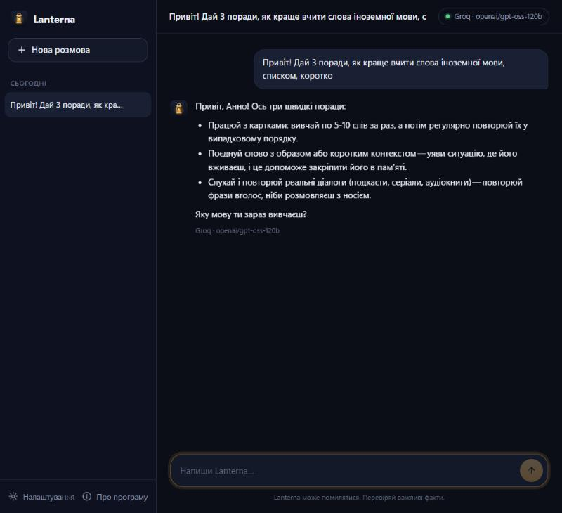

<p align="center"></p>

<h1 align="center">Lanterna</h1>
<p align="center">A friendly AI assistant that runs on <b>free cloud models</b> — or on <b>your own local models</b> if your PC is strong enough.<br>
<sub>by mikybuilds · MIT licence</sub></p>

> **Status: early development (v0.0.6).** The Windows app and the full-screen terminal app work, with memory, reminders, web search, weather, files and photos, automatic free-model discovery and fallback, and local models through Ollama. The Windows installer is coming — see the roadmap below.

<p align="center"></p>

## Why

Running a good model locally needs a strong graphics card. Lanterna lets anyone chat with a capable assistant using free tiers from cloud providers, and switches to local models (Ollama) on machines that can handle them.

- **Free.** Uses free API tiers. Lanterna never calls a paid model.
- **Private keys.** Your API keys are stored in your system's secure vault (Windows Credential Manager / GNOME Keyring), never in plain files or logs.
- **No telemetry.** Lanterna sends nothing to its author.
- **Human tone.** Warm, short when you're short, honest when it isn't sure.
- **English, Українська, Italiano.**

## Try it (developer preview)

```bash
pipx install git+https://github.com/mikybuilds/lanterna
lanterna
```

On first launch you pick a language, your name and your first free service:

| | Groq — *Fastest* | Google Gemini — *Smartest & most generous* |
|---|---|---|
| Speed | replies almost instantly | fast |
| Free limits | smaller daily limit | big free limits |
| Extras | strong open models (GPT-OSS, Qwen) | understands photos and documents, long memory |
| Get a key | [console.groq.com/keys](https://console.groq.com/keys) | [aistudio.google.com/apikey](https://aistudio.google.com/apikey) |

In a terminal `lanterna` opens a full-screen app (chats on the left, Ctrl+N new chat, Ctrl+S settings, Ctrl+O models). `lanterna chat` gives a simple line-by-line chat.

<p align="center"></p>

Window app: `pip install "lanterna[gui]"` then `lanterna-gui`, or build `Lanterna.exe` with `packaging/build_windows.ps1`.

Other commands: `lanterna models` (free models available right now), `lanterna key set <provider>`, `lanterna key list`, `lanterna setup`, `lanterna about`.

## Roadmap

- [x] Core, Groq chat in the terminal, secure key storage, personality
- [x] All free services (Groq, Gemini, OpenRouter, Cerebras, Mistral, GitHub Models) and automatic discovery of models that are free right now, with fallback when a limit is reached
- [x] Windows app (window with chats, settings, first-run setup)
- [ ] Windows installer (Setup.exe)
- [x] Full-screen terminal app for Ubuntu / GNOME (mouse + keyboard, same chats as the window app)
- [x] Memory, reminders, web search, files & photos, weather, exact math and dates
- [x] Local models via Ollama with hardware-based recommendations, and an Auto mode
- [ ] Voice

## What it can do

- **Remember** things you tell it ("remember that I'm allergic to peanuts"). You can see and edit the list in Settings.
- **Reminders** ("remind me in 20 minutes to stretch"): a system notification while Lanterna is open. Missed ones show up the next time you open it.
- **Search the web** (DuckDuckGo, no key) and read pages, with the site name as the source.
- **Weather and air quality** for any city (Open-Meteo, no key).
- **Files and photos**: PDF, Word, text and code files, and photos (📎 button, drag and drop, or Ctrl+F / `/file path` in the terminal).
- **Exact math and dates**: numbers are computed by code, not guessed by the model.

## Local models (optional)

If your PC has a graphics card, Lanterna can run models on it with [Ollama](https://ollama.com/download) (free). It checks your graphics card memory, RAM and free disk and suggests what fits:

| Graphics card memory | Suggested mode | Models |
|---|---|---|
| none / under 3 GB | Cloud | — (a tiny model only with 16 GB RAM, slow) |
| 3–5 GB | Auto | gemma4:e2b-it-qat, qwen3:4b, qwen3-vl:4b-instruct |
| 6–10 GB | Auto | gemma4:e4b-it-qat, qwen3:8b, qwen3-vl:8b-instruct |
| 11–19 GB | Local | gemma4:12b, qwen3:14b, qwen3-vl:8b-instruct |
| 20 GB and more | Local | gemma4:26b, qwen3:30b-a3b, qwen3-vl:30b-a3b-instruct |

- **Cloud**: free online models, works on any laptop.
- **Local**: everything stays on your computer.
- **Auto**: the local model answers everyday questions; long questions, proofs, code and analysis go to a bigger online model (you can turn this off in Settings). Photos go to the local photo model.

Downloads start only when you press **Download (X GB)**, with progress shown. In the terminal: `lanterna local` (what fits), `lanterna local pull qwen3:8b`, `lanterna local mode auto`.

## Good to know

Free limits are set by each provider and may change. Your memory list is stored on your computer and is sent to the model together with your messages, so it can use it. Web pages Lanterna reads are treated as information, never as instructions. In cloud mode your messages are processed by the provider you choose; for full privacy use local mode.

## Licence

MIT © 2026 mikybuilds
