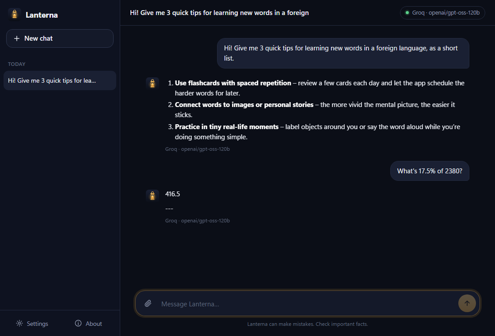
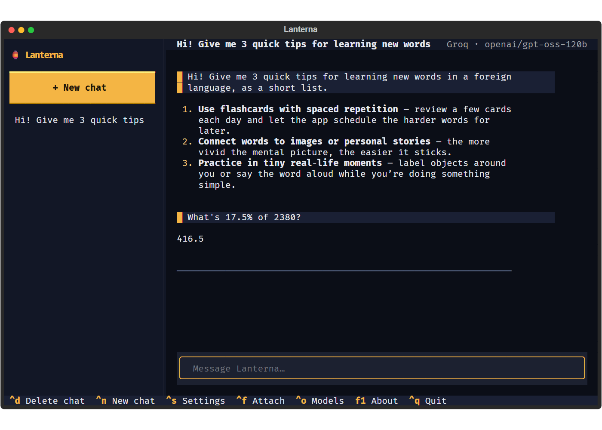
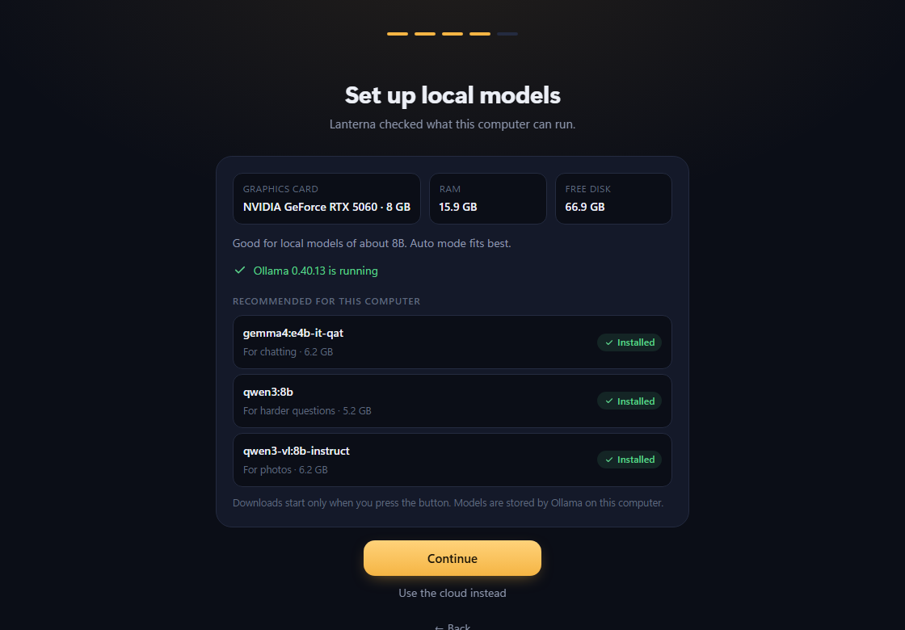
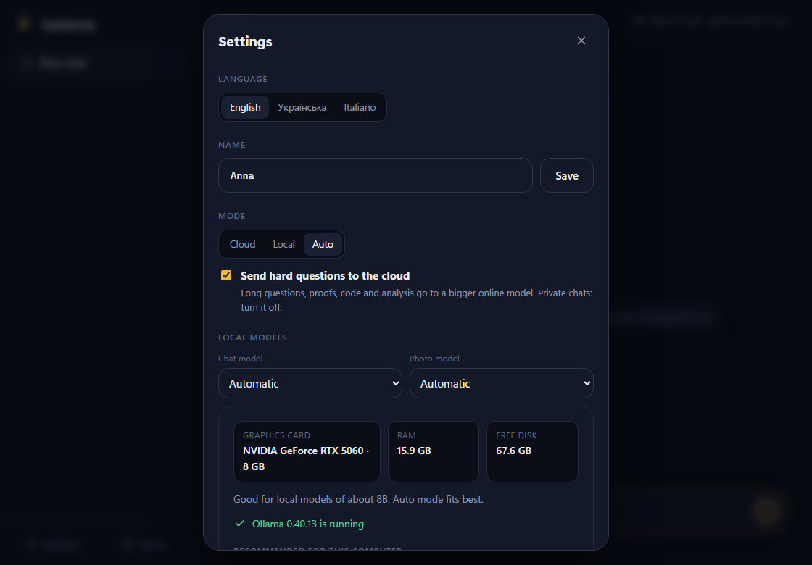
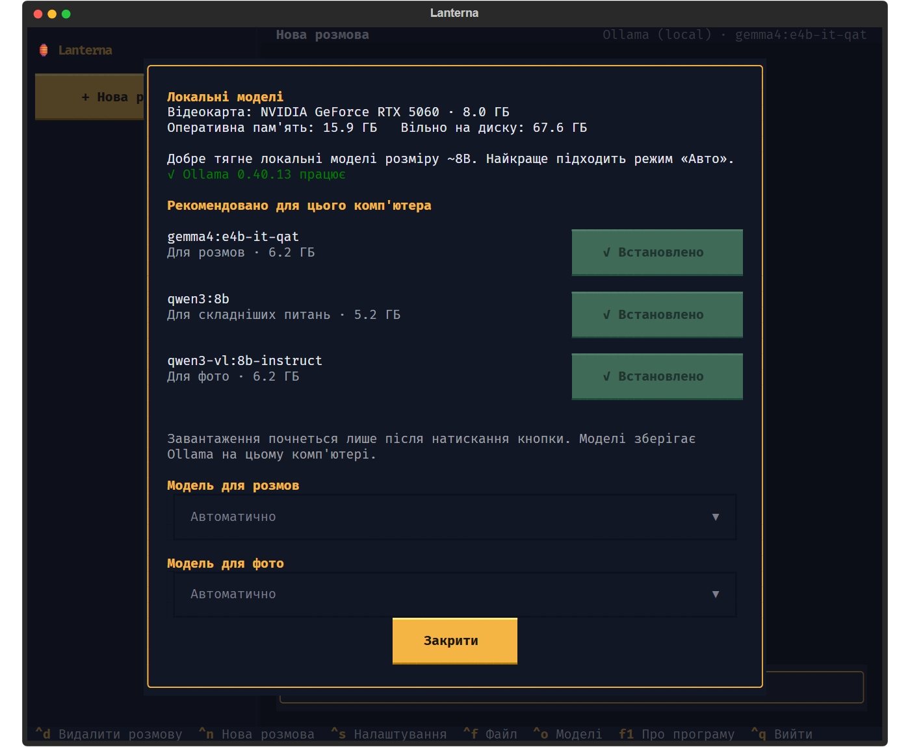

<p align="center"></p>

<h1 align="center">Lanterna</h1>
<p align="center">A friendly AI assistant that runs on <b>free cloud models</b> — or on <b>your own local models</b> if your PC is strong enough.<br>
<sub>by mikybuilds · MIT licence</sub></p>

> **Status: early preview (v0.1.1).** Windows window app and a full-screen terminal app for Linux, with memory, reminders, web search, weather, files and photos, free-model discovery with fallback, and optional local models through Ollama. Expect rough edges — [issues](../../issues) are welcome.

<p align="center"><b><a href="#windows-10--11">⬇ Install on Windows</a></b> · <b><a href="#linux">🐧 Install on Linux</a></b></p>

<p align="center"></p>

## Why

Running a good model locally needs a strong graphics card. Lanterna lets anyone chat with a capable assistant using free tiers from cloud providers, and switches to local models (Ollama) on machines that can handle them.

- **Free.** Uses free API tiers. Lanterna never calls a paid model.
- **Private keys.** Your API keys are stored in your system's secure vault (Windows Credential Manager, or GNOME Keyring / KWallet on Linux), never in plain files or logs.
- **No telemetry.** Lanterna sends nothing to its author.
- **Human tone.** Warm, short when you're short, honest when it isn't sure.
- **English, Українська, Italiano.**

## Install

### Windows 10 / 11

1. Open the [latest release](../../releases/latest) and download **`Lanterna-Setup-x.y.z.exe`**.
2. Run it. No admin rights needed; Lanterna appears in the Start menu.

> Windows will say **"Windows protected your PC" / Unknown publisher**: the installer isn't code-signed (signing costs money). Click **More info → Run anyway**. The installer is built from this repository by the [release workflow](.github/workflows/release.yml), so you can check what's inside. Prefer no installer? Take the portable zip from the same release.

### Linux

A full-screen app that runs in the terminal, with mouse support. Made for any desktop (GNOME, KDE Plasma, Xfce…) and distribution.

**You need:** Python **3.10 or newer**, plus `pipx` and `git`. Check your Python with `python3 --version` — Ubuntu 22.04+, Fedora 36+, Debian 12+, Linux Mint 21+, openSUSE Tumbleweed and Arch all have a new enough one.

**1.** Open a terminal and install pipx and git (once) with your system's package manager:

| Distribution | Command |
|---|---|
| Ubuntu, Debian, Linux Mint, Pop!_OS | `sudo apt update && sudo apt install -y pipx git` |
| Fedora | `sudo dnf install -y pipx git` |
| Arch, Manjaro | `sudo pacman -S --needed python-pipx git` |
| openSUSE | `sudo zypper install python3-pipx git` |

Then run this, close the terminal and open a new one:

```bash
pipx ensurepath
```

**2.** Install Lanterna:

```bash
pipx install git+https://github.com/mikybuilds/lanterna
```

**3.** Add it to your app menu (optional), then find it there by typing *Lanterna*:

```bash
lanterna desktop
```

Or just type `lanterna` in any terminal.

Update: Lanterna tells you when a new version is out; then run `pipx upgrade lanterna` · Remove: `lanterna desktop --remove && pipx uninstall lanterna`

Keys are kept in your system keyring (GNOME Keyring, KWallet). On a server without a keyring, set the key as an environment variable instead (e.g. `GROQ_API_KEY`).

> Tested automatically on Ubuntu 22.04 and 24.04 on every change. Other distributions use the same steps; if something doesn't work, please [open an issue](../../issues).

### First launch

On first launch you pick a language, your name and your first free service:

| | Groq — *Fastest* | Google Gemini — *Smartest & most generous* |
|---|---|---|
| Speed | replies almost instantly | fast |
| Free limits | smaller daily limit | big free limits |
| Extras | strong open models (GPT-OSS, Qwen) | understands photos and documents, long memory |
| Get a key | [console.groq.com/keys](https://console.groq.com/keys) | [aistudio.google.com/apikey](https://aistudio.google.com/apikey) |

In a terminal `lanterna` opens a full-screen app (chats on the left, Ctrl+N new chat, Ctrl+S settings, Ctrl+O models). `lanterna chat` gives a simple line-by-line chat.

<p align="center"></p>

Other commands: `lanterna models` (free models available right now), `lanterna local` (local models), `lanterna key set <provider>`, `lanterna key list`, `lanterna setup`, `lanterna about`.

## Roadmap

- [x] Core, Groq chat in the terminal, secure key storage, personality
- [x] All free services (Groq, Gemini, OpenRouter, Cerebras, Mistral, GitHub Models) and automatic discovery of models that are free right now, with fallback when a limit is reached
- [x] Windows app (window with chats, settings, first-run setup)
- [x] Windows installer (Setup.exe) and portable zip, built by the release workflow
- [x] Update notice at start with steps for your kind of install (can be turned off)
- [x] Full-screen terminal app for Linux (mouse + keyboard, same chats as the window app)
- [x] Memory, reminders, web search, files & photos, weather, exact math and dates
- [x] Local models via Ollama with hardware-based recommendations, and an Auto mode
- [ ] Voice

## What it can do

- **Remember** things you tell it ("remember that I'm allergic to peanuts"). You can see and edit the list in Settings.
- **Reminders** ("remind me in 20 minutes to stretch"): a system notification while Lanterna is open. Missed ones show up the next time you open it.
- **Search the web** (DuckDuckGo, no key) and read pages, with the site name as the source.
- **Weather and air quality** for any city (Open-Meteo, no key).
- **Files and photos**: PDF, Word, text and code files, and photos (📎 button, drag and drop, or Ctrl+F / `/file path` in the terminal).
- **Exact math and dates**: numbers are computed by code, not guessed by the model.

## Local models (optional)

If your PC has a graphics card, Lanterna can run models on it with [Ollama](https://ollama.com/download) (free). It checks your graphics card memory, RAM and free disk and suggests what fits:

| Graphics card memory | Suggested mode | Models |
|---|---|---|
| none / under 3 GB | Cloud | — (a tiny model only with 16 GB RAM, slow) |
| 3–5 GB | Auto | gemma4:e2b-it-qat, qwen3:4b, qwen3-vl:4b-instruct |
| 6–10 GB | Auto | gemma4:e4b-it-qat, qwen3:8b, qwen3-vl:8b-instruct |
| 11–19 GB | Local | gemma4:12b, qwen3:14b, qwen3-vl:8b-instruct |
| 20 GB and more | Local | gemma4:26b, qwen3:30b-a3b, qwen3-vl:30b-a3b-instruct |

- **Cloud**: free online models, works on any laptop.
- **Local**: everything stays on your computer.
- **Auto**: the local model answers everyday questions; long questions, proofs, code and analysis go to a bigger online model (you can turn this off in Settings). Photos go to the local photo model.

Downloads start only when you press **Download (X GB)**, with progress shown. In the terminal: `lanterna local` (what fits), `lanterna local pull qwen3:8b`, `lanterna local mode auto`.

<p align="center"></p>
<p align="center"> </p>

## Privacy

- **No telemetry, no account with Lanterna.** Chats, memory and reminders are stored in a local database in your user folder.
- **Cloud mode:** your messages go only to the service you chose (Groq, Gemini…), under its own terms. **Local mode:** nothing leaves your computer.
- Your memory list is sent to the model together with your messages, so it can use it. You can see and delete it in Settings.
- Web pages and files Lanterna reads are treated as information, never as instructions.
- The only request Lanterna makes on its own is the update check when it starts (a plain request for the latest release, nothing about you). Turn it off in **Settings → Updates**.
- Bug reports are never sent automatically: you see the whole text and send it yourself (see below).

## Found a bug?

Open **About → Report a bug** (or **Settings → Found a bug?**, or `lanterna bug` in a terminal). Write what happened; Lanterna adds the version, the system, the mode and the last errors — never chats, memory, keys or your name, and you can untick that. You see the exact text, then open it as a [GitHub issue](../../issues) or copy it. Sending it by e-mail from your own mail app is coming soon.

## Good to know

Free limits are set by each provider and may change. macOS is not tested yet.

## Development

```bash
python -m venv .venv && . .venv/bin/activate        # Windows: .venv\Scripts\activate
pip install -e ".[dev,gui]"
python -m pytest -q                                  # tests (no network, no keys needed)
python tools/scan_secrets.py --history               # make sure no key, e-mail or personal path is committed
lanterna-gui --browser                               # window UI in your browser (dev server on 127.0.0.1)
```

Windows build: `powershell -ExecutionPolicy Bypass -File packaging\build_windows.ps1` (also makes Setup.exe when Inno Setup 6 is installed). Releases: bump `__version__`, add a `CHANGELOG.md` entry, push a tag `vX.Y.Z` — the release workflow tests, builds and publishes the installer.

## Licence

MIT © 2026 mikybuilds
